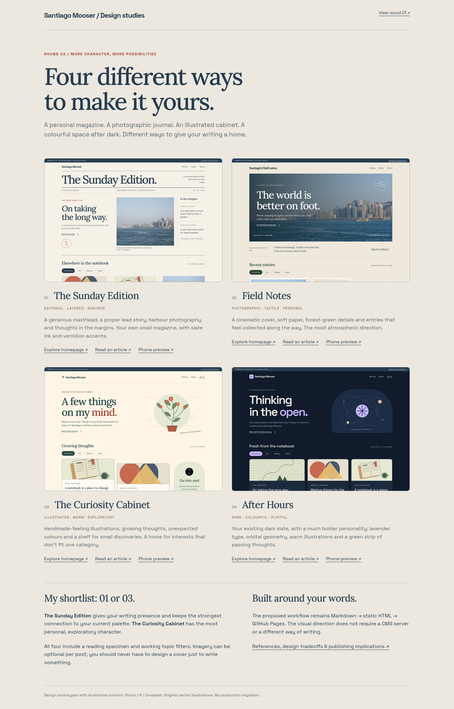

# Four different ways to make it yours

Round 02 responds to the request for designs that are less minimalist and more varied. Four new directions change composition, typography, imagery and colour, while keeping the focus on personal writing.



| Direction                  | Character                                                              | Homepage                          | Article                           | Phone                            |
| -------------------------- | ---------------------------------------------------------------------- | --------------------------------- | --------------------------------- | -------------------------------- |
| 01 — The Sunday Edition    | Personal magazine; slate ink, cream paper, lead story and margin notes | [Preview](edition-desktop.png)    | [Preview](edition-reading.png)    | [Preview](edition-mobile.png)    |
| 02 — Field Notes           | Photographic journal; wide harbour cover and tactile paper             | [Preview](field-desktop.png)      | [Preview](field-reading.png)      | [Preview](field-mobile.png)      |
| 03 — The Curiosity Cabinet | Illustrated personal space; staggered cards and a small shelf          | [Preview](cabinet-desktop.png)    | [Preview](cabinet-reading.png)    | [Preview](cabinet-mobile.png)    |
| 04 — After Hours           | Colourful dark site; lavender type and orbital artwork                 | [Preview](afterhours-desktop.png) | [Preview](afterhours-reading.png) | [Preview](afterhours-mobile.png) |

My shortlist is **01 or 03**. [Read the references, tradeoffs and publishing implications](RESEARCH.md).

## Explore the prototypes

Open `index.html` in a browser, or serve the repository root:

```sh
python -m http.server 8765 --bind 127.0.0.1
```

Visit `http://localhost:8765/design-study-v2/`. Each direction includes a homepage, article specimen, topic filtering, and navigation to writing, short notes and an About footer. All sample titles open the same article specimen. The CV link uses the existing PDF.

This is a visual exploration, not a production migration. All biography and post copy is illustrative. Each design has its own fixed palette in this round; the prototypes do not have appearance toggles or a connected authoring backend. The existing site is unchanged.

## Source and assets

`build.py` contains shared sample content and templates, and generates the eight page specimens plus five original vector illustrations. Run from the repository root:

```sh
python design-study-v2/build.py
```

`style.css` contains the common foundation and four distinct layouts. `ui.js` provides progressive topic filtering; all posts remain readable with JavaScript disabled. Fonts and imagery are local. Asset provenance and licenses are documented in [RESEARCH.md](RESEARCH.md).

Design references: [Austin Kleon](https://austinkleon.com/), [Craig Mod](https://craigmod.com/), [Maggie Appleton](https://maggieappleton.com/), and [Josh W. Comeau](https://www.joshwcomeau.com/).

## Verification

The existing résumé validated and built successfully with `npm ci`, `npm run validate` and `npm run build`.

`verify.cjs` runs Firefox checks with Playwright and regenerates screenshots. It checks 32 homepage/article viewport combinations (1440, 768, 390 and 320 pixels), every topic filter, local links and fragment targets, loaded images, article navigation, About/CV presence, horizontal overflow, and reading with JavaScript disabled. It also captures the comparison gallery and desktop/mobile article previews. Browser testing for this round uses Firefox; cross-browser production verification remains a future implementation check.

Use an existing Playwright 1.59.1 installation with the matching Firefox bundle. `PLAYWRIGHT_MODULE_PATH` can point to an external Playwright installation so this study does not add dependencies to the production site:

```sh
PLAYWRIGHT_MODULE_PATH=/path/to/node_modules/playwright \
PLAYWRIGHT_BROWSERS_PATH=/path/to/matching/browser-bundle \
node design-study-v2/verify.cjs
```

The previous exploration remains available in [design-study](../design-study/README.md).
