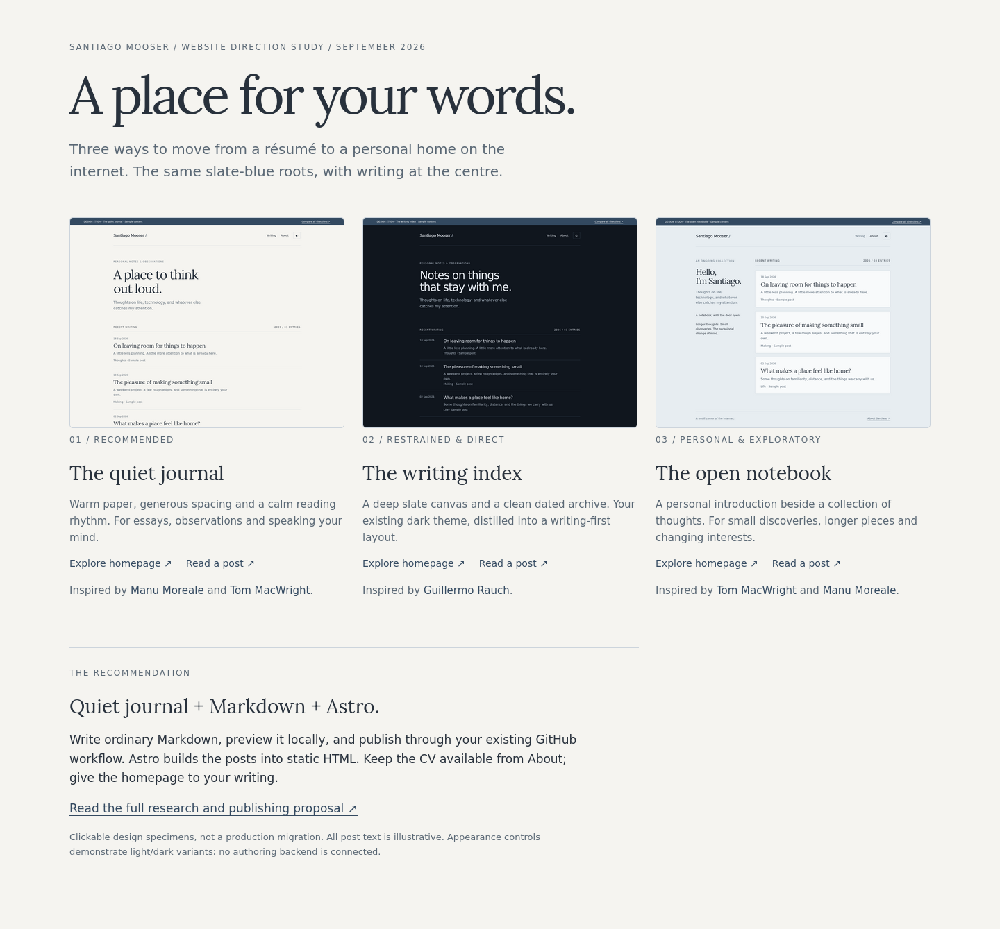

# A place for your words

Three proposed directions for Santiago's personal website. Recommendation: **the quiet journal, built with Astro and Markdown, deployed through GitHub Pages**.



| Direction          | Character                                   | Homepage                        | Article                         | Phone                          |
| ------------------ | ------------------------------------------- | ------------------------------- | ------------------------------- | ------------------------------ |
| 01 — Quiet journal | Warm paper, serif titles, spacious reading  | [Preview](journal-desktop.png)  | [Preview](journal-reading.png)  | [Preview](journal-mobile.png)  |
| 02 — Writing index | Dark slate, sans-serif, dated archive       | [Preview](archive-desktop.png)  | [Preview](archive-reading.png)  | [Preview](archive-mobile.png)  |
| 03 — Open notebook | Personal sidebar, pale slate writing sheets | [Preview](notebook-desktop.png) | [Preview](notebook-reading.png) | [Preview](notebook-mobile.png) |

[Read the research, alternatives and publishing proposal](RESEARCH.md).

Open `index.html` in a browser for clickable prototypes, or serve the repository root:

```sh
python -m http.server 8765 --bind 127.0.0.1
```

Visit `http://localhost:8765/design-study/`. Each direction includes an article specimen, an About page, and light/dark appearance controls. This is a design study with illustrative copy, not a deployed blog or connected editor.

Reference sites: [Manu Moreale](https://manuelmoreale.com/), [Tom MacWright](https://macwright.com/), [Guillermo Rauch](https://rauchg.com/). See the research for what each direction borrows and its tradeoffs.

[Current theme, rendered from repository main](current-desktop.png).

## Verification

- Existing site: `npm ci`, `npm run validate`, and `npm run build` passed.
- Firefox via Playwright 1.59.1: 18 page checks across 1440px and 390px viewports passed, covering home/article/About navigation, appearance switching and horizontal overflow.
- Local links and assets resolve; reading and navigation work with JavaScript disabled.
- Desktop, phone and article screenshots captured; comparison and journal reading specimens visually inspected.
- Chromium screenshot capture timed out in this Nix environment; Chromium visual verification remains unconfirmed. This study does not claim to test the proposed future Astro publishing pipeline.
